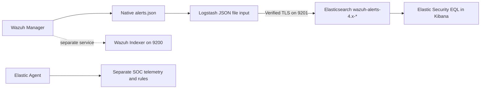

# Architecture

Project: **Wazuh EQL Correlation** (`wazuh-eql-correlation`); see the [project overview](../README.md).

## Purpose and boundaries

Wazuh provides native rules, frequency/timeframe logic and correlation capabilities. This integration adds Elastic EQL for the required multi-event sequence detection across Wazuh alert documents. It does not replace Wazuh rules or assume Wazuh lacks correlation.

Port 9201 is the reference deployment's Elasticsearch endpoint, not a universal default. Ports and endpoints must be configured for each deployment. The Wazuh Indexer is separate from Elasticsearch at `https://localhost:9201`; it is not the EQL engine here. Elastic Agent rules and indices remain independent of the Wazuh correlation stream. No SOAR, remediation, Python SOC Automation Service or Automated Cybersecurity Remediation Platform dependency is introduced.

## Native event contract

The JSON input retains native nested fields such as `rule.id`, `agent.id`, `data` and `syscheck`. The input supplies `type = wazuh-alerts` when applicable under Logstash's type behaviour; a pre-existing event type may be retained, so verify actual indexed values. Logstash may add ingestion metadata such as `@timestamp` and `path`. No filters rename native fields or add ECS normalisation. The event's `timestamp` remains the EQL ordering field. Index date interpolation uses Logstash `@timestamp` (normally ingestion time unless supplied), which can differ from `timestamp`; search index date ranges accordingly.

## Sequence semantics

All supplied queries use `any` stages. EQL metadata is `timestamp_field = timestamp` and `event_category_field = type.keyword`. The category field still needs valid mappings even though stages do not restrict a particular category. A sequence requires events in stage order within `maxspan`; it does not imply causation. Delayed arrival, gaps, clock skew, FIM observation timing and equal timestamps affect results. No tiebreaker field is supplied, so equal-time ordering needs lab investigation rather than assumptions.

Most joins use only `agent.id.keyword`: a shared agent is not a shared session or actor. WEB-001 also joins the reported source IP, whose attribution may be uncertain behind a reverse proxy. WEB-004 does not join a created file to the same requested URL. Windows range from 10 to 60 minutes; they constrain sequence span, not ingestion delay or the scheduling look-back of a future detection rule.

The reference pipeline has a persistent file checkpoint. Persistent queue configuration belongs separately in Logstash settings; see [configuration](configuration.md). Delivery is not exactly once. Retries, checkpoint loss and replay can cause duplicates, while rotation, outages and insufficient retention can cause loss.
